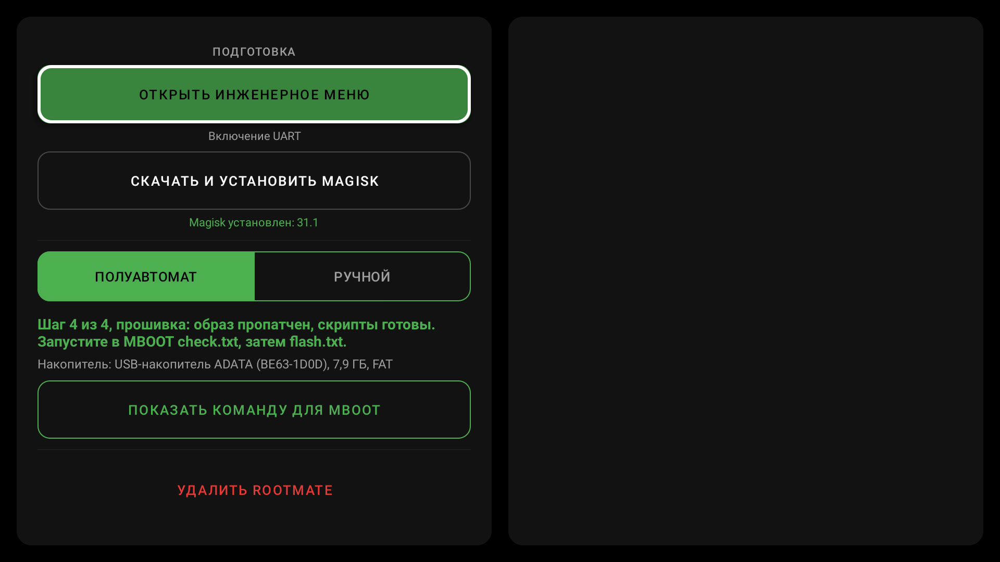

# Root for Tuvio TO55UFGCV5 / CHiQ on MT5889

🇷🇺 [Русская версия](README.md)

Step-by-step guide to rooting TVs with the **MStar MBOOT (U-Boot 2011.06)** bootloader using Magisk: UART over HDMI, backup, patching the boot image on the TV itself with the **RootMate** app, changing the bootloader state, data wipe, eMMC write and recovery.

## Start here

1. [Full rooting guide and rollback](docs/guide.en.md)
2. [Download RootMate.apk](https://github.com/Tobirg/changhong_m9617_root/releases/latest) (built automatically by [GitHub Actions](https://github.com/Tobirg/changhong_m9617_root/actions))
3. [Recovery and troubleshooting](docs/recovery.en.md)

## RootMate

An Android TV app that replaces everything that used to be done on a PC:

- downloads and installs the latest Magisk;
- patches the original `BOOT_*.IMG` from a USB drive (including the `skip_initramfs` fix), no PC and no manual work in Magisk;
- opens the engineering menu to enable UART.

The bootloader part (UART/MBOOT) is still done by hand, see the guide.

## Extras

- [skip_initramfs fix via adb shell](scripts/skipfix.sh) (fallback)
- [App development notes](docs/app.md) (in Russian)
- [Guide for agents (AI/scripts): RootMate over adb, MBOOT over UART](docs/agent.md)
