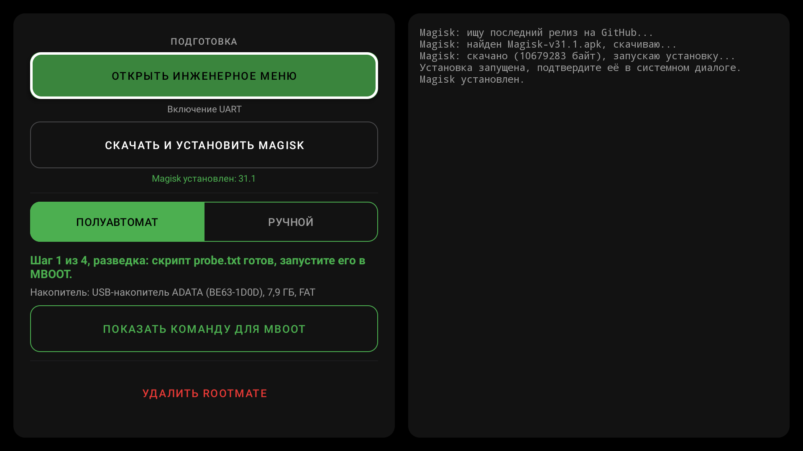
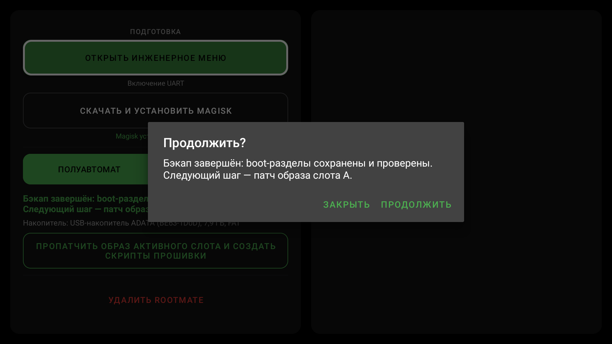

# Root для Android TV на MediaTek MT5889 (MStar MBOOT)

🇬🇧 [English version](README.en.md)

Получение root с Magisk на телевизорах с SoC **MT5889** и загрузчиком **MStar MBOOT (U-Boot 2011.06)**. Приложение **RootMate** на самом ТВ снимает бэкап boot-разделов, патчит образ и готовит скрипты прошивки, а вы запускаете их в консоли загрузчика через UART (адаптер подключается к HDMI). Всё, что зависит от модели (разделы, адреса памяти, активный слот), берётся с самого ТВ.

**Способ проверен на:** Tuvio TO55UFGCV5, DEXP 55OCG. На других ТВ с MT5889 и MBOOT он может работать, но это не проверено: начинайте с бэкапа и проверочного `check.txt`.

## Начать здесь

- 📖 [Инструкция: получение root и откат](docs/guide.md)
- ⬇️ [Скачать RootMate](https://github.com/Tobirg/changhong_m9617_root/releases/latest) (APK собирается [GitHub Actions](https://github.com/Tobirg/changhong_m9617_root/actions))
- 🛟 [Восстановление при ошибках](docs/recovery.md)

## Как это устроено

1. **UART.** Самодельный адаптер USB–UART подключается к HDMI-порту ТВ, UART включается в инженерном меню (кнопка в RootMate).
2. **RootMate на ТВ.** Приложение запрашивает разрешения (файлы, установка Magisk, режим разработчика и отладка по USB) и само ставит последний Magisk.
3. **Полуавтомат, четыре шага.** Разведка → бэкап → патч → проверка и прошивка. На каждом шаге приложение пишет на USB-накопитель скрипт, сам перезагружает ТВ, а вы в консоли MBOOT вводите две команды: `usb start 1` и `udstar <скрипт>`.
4. **Сброс данных и Magisk.** Если ТВ не был разблокирован, прошивка заканчивается сбросом данных; после него ставите Magisk заново и получаете root.

## Как скрипты защищают от ошибок

- Ни одного зашитого значения: таблица разделов, размеры, адреса памяти и активный слот читаются с вашего ТВ на шаге разведки.
- Бэкап читается обратно с накопителя и сверяется с eMMC, приложение отдельно проверяет CRC32 каждого образа.
- `check.txt` выполняет все проверки прошивки, ничего не записывая. `flash.txt` повторяет их (слот, CRC32 оригинала и пропатченного образа), пишет, читает обратно и сверяет; при любой ошибке останавливается до записи.
- `rollback.txt` возвращает оригинальный образ теми же проверками.

## Что потребуется

- USB–UART адаптер **TTL 3,3 В** и разъём или кабель HDMI под распайку.
- ПК с терминалом (MobaXterm, PuTTY): только для консоли MBOOT.
- USB-накопитель FAT32, один раздел.

## Возможности RootMate

| | |
| --- | --- |
| **Полуавтомат** | ведёт по шагам, распознаёт этап по файлам на накопителе, выбирает накопитель один раз и отклоняет неподходящие (exFAT/NTFS, FAT не на первом разделе) |
| **Ручной** | полный патч выбранного `BOOT_*.IMG` с фиксом `skip_initramfs` или только фикс образа, уже пропатченного Magisk |
| **Magisk** | скачивает последний релиз с GitHub и устанавливает |
| **Перезагрузка в MBOOT** | через собственный adb ТВ, без root |
| **Агенты** | тот же процесс по adb с ответами в JSON, плюс скрипты для консоли MBOOT: [docs/agent.md](docs/agent.md) |

Фикс `skip_initramfs`: на этой версии MBOOT в командной строке ядра есть `skip_initramfs`, из-за которого Magisk выбирает неверный режим загрузки. RootMate меняет его на `skip_initramfz` внутри magiskinit.

## Дополнительно

- [Инструкция для агентов (ИИ, скрипты): RootMate по adb, MBOOT по UART](docs/agent.md)
- [Скрипт фикса skip_initramfs через adb shell](scripts/skipfix.sh) (запасной вариант)
- [Заметки по приложению для доработок](docs/app.md)
