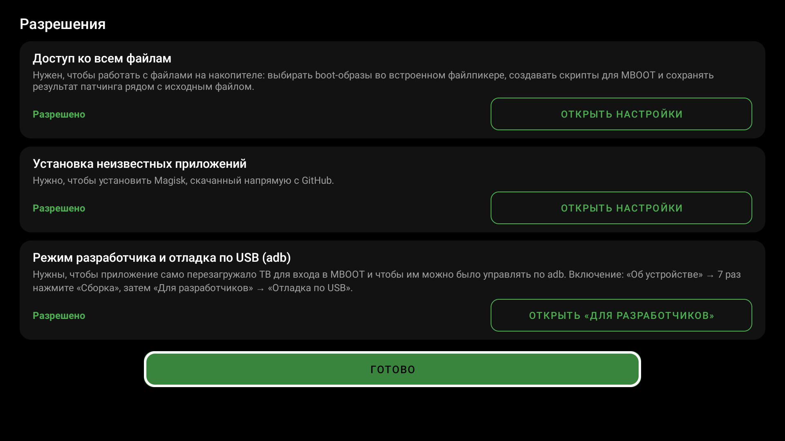
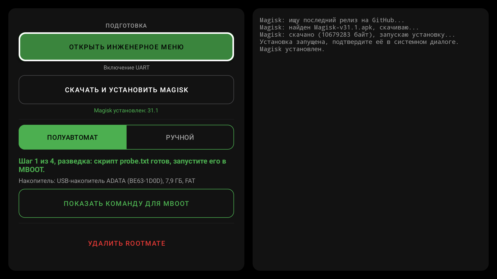
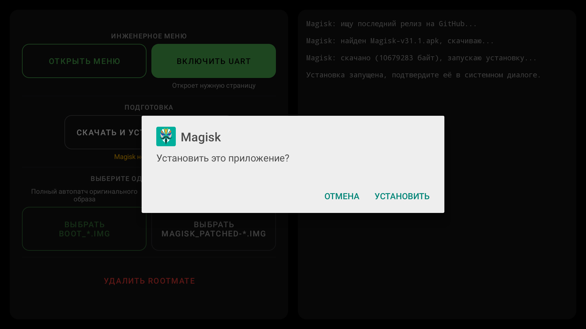
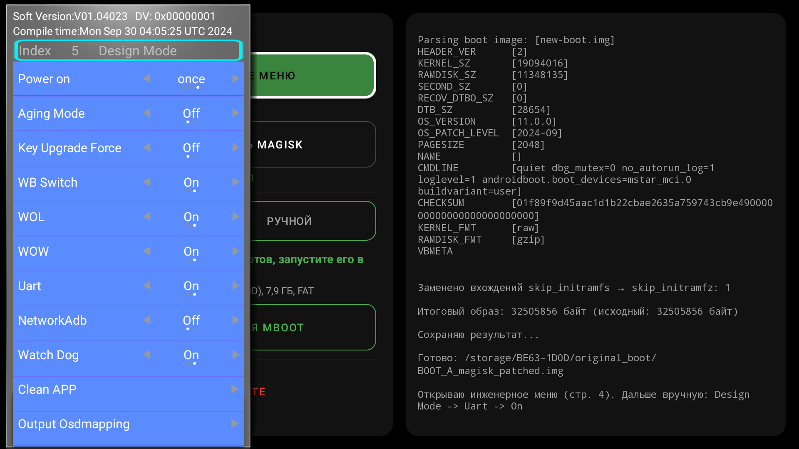
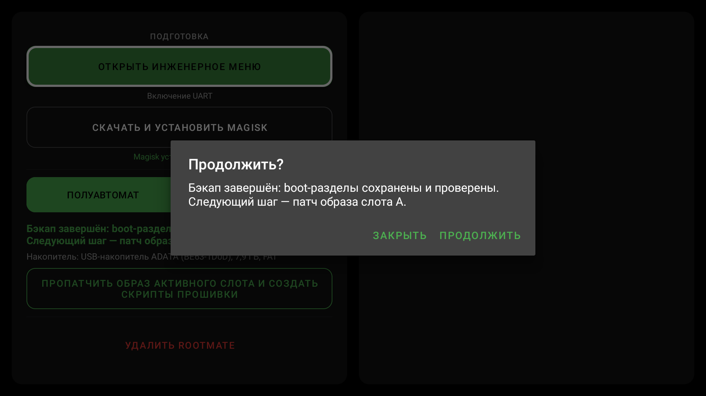
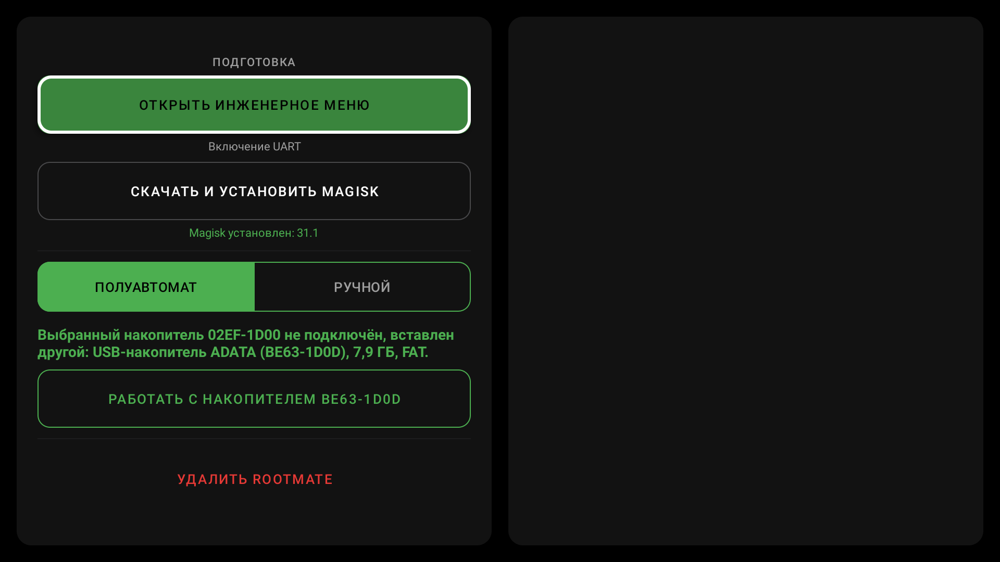
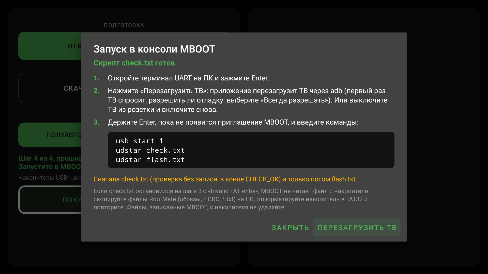
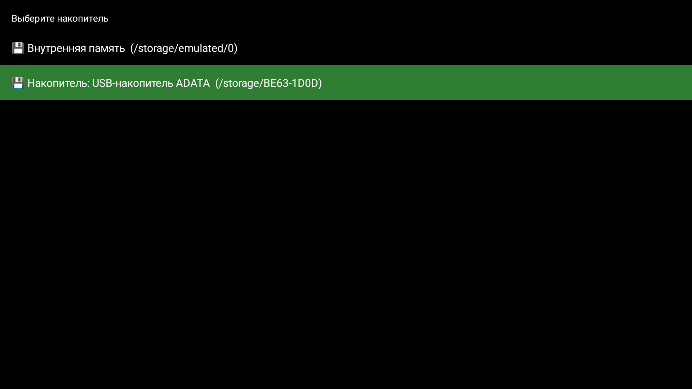
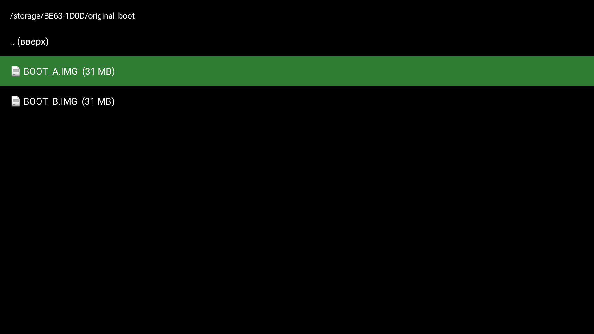
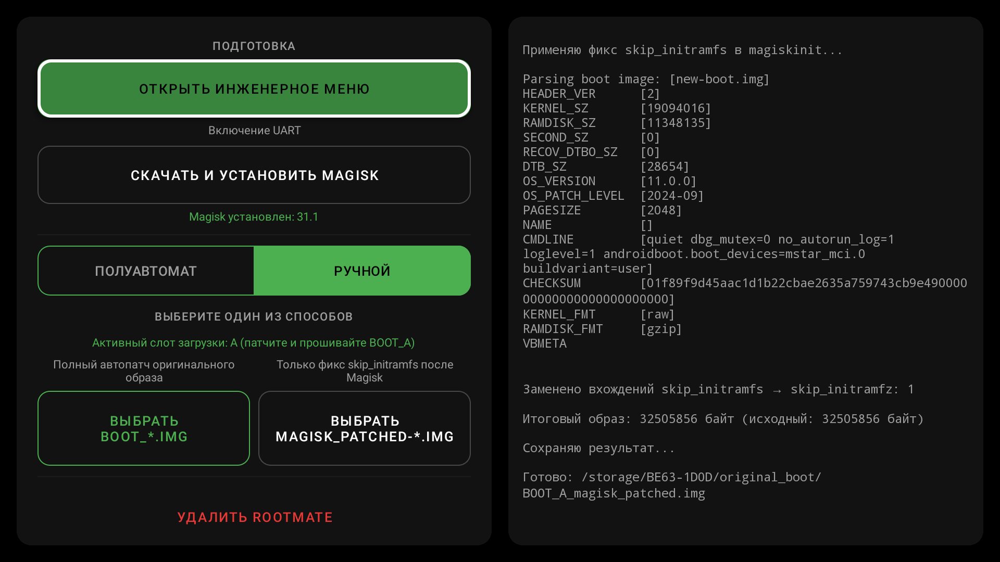

# Rooting MT5889 with RootMate

🇷🇺 [Русская версия](guide.md)

**Important:** rooting risks irreversible data loss and a bricked TV. On the tested unit, changing the Verified Boot state required a full data reset because of incompatible encryption keys. The method is tested on Tuvio TO55UFGCV5 and DEXP 55OCG; it is not guaranteed to work on other models and firmware.

**Overview.** You connect the UART adapter to HDMI and turn UART on in the TV's engineering menu. Then the **RootMate** app on the TV walks you through four steps: **probe → backup → patch → check and flash**. At every step it writes a script to the USB drive, and you run it in the MBOOT bootloader console over UART with two commands. Everything that depends on the particular TV (partitions, sizes, RAM addresses, the active slot) the app takes from the TV itself. Every script checks first and writes only after that; any mismatch stops it. The PC is needed only for the UART terminal.

The manual way (your own MBOOT commands, patching a picked file) stays as a fallback: [appendices at the end](#appendix-a-rootmate-manual-mode).

## 1. What you need

- A USB–UART **TTL** adapter (not RS-232 ±12 V).
- An HDMI connector: solder/terminal type, or sacrifice an old cable. You can also open the TV and connect to the board UART, but buying a cable is cheaper than cracking the panel.
- A UART terminal: MobaXterm, PuTTY or similar (it must send keystrokes immediately, not via a separate Send button).
- A PC: for the UART terminal and copying files.
- A USB drive formatted as **FAT32**, a single partition.
- Internet on the TV (RootMate downloads Magisk by itself) or the Magisk APK on the drive.

## 2. The UART adapter via HDMI

| TV HDMI pin | Function (TV side) | USB–UART |
| --- | --- | --- |
| **2** | **TX** of the TV | **RX** of the adapter |
| **8** | GND | GND of the adapter |
| **14** | **RX** of the TV | **TX** of the adapter |

Terminal settings: **115200, 8N1, no flow control**. Do not connect the adapter's VCC.

The adapter goes into **HDMI port 3** (counting from the bottom), the drive into **the USB port closer to the panel**: only that one is seen by `usb start 1` in MBOOT.

## 3. Prepare the USB drive

On a PC, format the drive as **FAT32**, a single partition. Download and copy to it:

- **RootMate-1.0.apk**: [latest release](https://github.com/Tobirg/changhong_m9617_root/releases/latest).
- Optionally the [Magisk APK](https://github.com/topjohnwu/Magisk/releases/latest): needed if the TV has no internet.

> **Do not delete files MBOOT wrote to the drive** (`PTABLE.BIN`, `ENV.TXT`, `*.IMG`, `*.CRC`, `*.OK`), even when you no longer need them. MBOOT marks the end of a file in the FAT with `0xFFFFFFFF`; if such a file is deleted and Android reuses its space, MBOOT cannot read new files (`Invalid FAT entry`). To start over, copy what you need to a PC and format the whole drive. Files the app wrote (`*.txt`, `*_magisk_patched*.img`) may be deleted.

## 4. Install RootMate and prepare the TV

Put the drive into the TV, open the stock file manager and install **RootMate-1.0.apk** (allow installs from unknown sources). If the file manager cannot open APKs, use `adb install`.

Open RootMate. On the first start it shows the **Permissions** screen; grant all three:

- **All files access**: working with the files on the drive.
- **Install unknown apps**: installing Magisk.
- **Developer options and USB debugging (adb)**: so the app can reboot the TV into MBOOT by itself. The button opens the right settings page: first "About", where you press **Build** 7 times, then "Developer options", where you turn on **USB debugging**.

The main screen: buttons on the left, the log on the right.

Press **Download and install Magisk** (Скачать и установить Magisk). The app finds the latest release on GitHub, downloads it and starts the install; confirm in the system dialog (**Install**). A line **Magisk installed: 31.1** appears under the button. You do not need to open Magisk or patch anything in it.

## 5. Turn UART on

On many firmwares UART is off in the TV: the terminal stays silent and you cannot get into the MBOOT console. Turn it on before the steps, from Android:

1. In RootMate press **Open the engineering menu** (Открыть инженерное меню, caption "Turns UART on"). The **Design Mode** page of the engineering menu opens.
2. Select the **Uart** line and switch it to **On** with the remote's arrows. Do not touch the other items.
3. Leave with Back (you may need to press it twice).

The setting survives reboots. Check: open the terminal (115200, 8N1) and reboot the TV (in RootMate or by unplugging it); the boot log must scroll in the terminal. If it stays empty, check that TX and RX are not swapped and that the adapter is in HDMI port 3.

## 6. Semi-auto: four steps

The **Semi-auto** mode is selected at start. Under the mode switch the app shows which step you are on (e.g. "Step 1 of 4, probe: not started yet"), which drive it works with and what to do next (the main button). The step is recognised from the files on the drive, so after every reboot the app continues from the right place and offers the next action.

The drive for the steps is chosen once. With several drives plugged in, the app asks which one to use. A formatted drive gets a new serial number: the app offers to switch to it with one button. A drive in exFAT/NTFS, or with FAT not on the first partition, is rejected right away: MBOOT cannot read it.

### Running a script in MBOOT

After every script it creates, the app shows a hint with the commands:

1. Open the UART terminal on the PC, make its window active and **hold Enter**.
2. In the app press **Reboot the TV** (Перезагрузить ТВ). The first time the TV asks "Allow USB debugging?": choose **Always allow**. Without adb, simply unplug the TV and plug it in again.
3. **Keep holding Enter** until the terminal shows the prompt:
   ~~~text
   << MT5889 >>#
   ~~~
4. Type the commands from the hint, for example:
   ~~~text
   usb start 1
   udstar probe.txt
   ~~~

`usb start 1` must find the drive:
~~~text
1 USB Device(s) found
       scanning bus for storage devices... max lun:0
1 Storage Device(s) found
~~~
If it answers `Error, couldn't init Lowlevel part`, repeat `usb stop` and `usb start 1`. With 0 devices the drive is in the wrong USB port.

At the start `udstar` prints `Saving Environment to MMC`: that is MBOOT saving its own variables, partitions are not touched. Every script prints its steps and a success marker at the end. Probe, backup and flash reboot the TV into Android by themselves.

### Step 1. Probe

Main button **Create the probe script** (Создать скрипт разведки): the app writes `probe.txt` to the drive. Run it in MBOOT (`usb start 1`, `udstar probe.txt`). The script writes nothing to the eMMC: it saves the partition table `PTABLE.BIN` and the bootloader environment `ENV.TXT` (it contains the TV's serial number, do not publish it), prints `PROBE_OK` and reboots the TV.

### Step 2. Backup

After the boot open RootMate: it sees the probe result and offers to continue. Button **Create the backup script** (Создать скрипт бэкапа): the app writes `backup.txt` with the names, sizes and RAM addresses of your very TV. Run it in MBOOT (`udstar backup.txt`).

The script saves `boot_a`, `boot_b` and `misc` to `BOOT_A.IMG`, `BOOT_B.IMG`, `MISC.IMG` (if such files exist, it takes `_2`, `_3`…), reads every file back and compares it with the eMMC, and writes `*.CRC` next to them. It writes nothing to the eMMC. The app then recomputes CRC32 and sizes itself and only after that counts the backup as done.

**Copy `BOOT_A.IMG` and `BOOT_B.IMG` to a PC right away and keep them.** They are the only way back.

> If the TV was already rooted, the backup of the active slot is already patched by Magisk. The patch is still built correctly, but the app warns: `rollback.txt` would bring back this same patched image, not the stock one. Keep the stock image separately for a rollback.

### Step 3. Patch

Button **Patch the active slot image and create the flash scripts** (Пропатчить образ активного слота и создать скрипты прошивки; needs Magisk). The app by itself:

- takes the image of the **active slot** from the backup (the one the TV boots from now; flashing the other slot is useless);
- runs `boot_patch.sh` from the installed Magisk and applies the `skip_initramfs` fix (below);
- saves `BOOT_X_magisk_patched.img` next to the backup (the same size as the original, 32505856 bytes);
- writes `check.txt`, `flash.txt` and `rollback.txt` with your slot, file names and CRC32 checksums.

It takes about a minute, the buttons are locked meanwhile. Do not leave the app.

> **What the skip_initramfs fix is.** This MBOOT version puts `skip_initramfs` on the kernel command line, which makes Magisk wrongly choose Legacy SAR instead of First Stage Init. Replacing one character in **magiskinit** (the `init` file in the ramdisk) helps: `skip_initramfs` → `skip_initramfz`. RootMate does it with `magiskboot` from Magisk itself.

### Step 4. Check and flash

Back in MBOOT, as the app's hint says:

~~~text
usb start 1
udstar check.txt
~~~

`check.txt` runs all the checks of the flash without writing anything: the active slot in `misc`, CRC32 of the backup and of the patched image. It must end with `CHECK_OK_slot_a_nothing_written` (or `_b`). You do not need to leave the console.

**Only after `CHECK_OK`**:

~~~text
udstar flash.txt
~~~

`flash.txt` repeats the checks, unlocks the bootloader (`devicestate unlock`), writes the image to the boot partition of the active slot, reads it back and compares, then reboots the TV. Any failed check stops the script before the write.

**If the TV is not unlocked yet** (the boot state is not `orange`), `flash.txt` ends with **a wipe of user data**: without it the TV does not boot because of the encryption keys. After the wipe set the TV up again, developer options and debugging included; RootMate and Magisk are gone with the data. Install Magisk again: the APK from the drive, or **RootMate-1.0.apk** → **Download and install Magisk**. **Right after installing press "Open"**: there is no icon in the stock launcher (later it can be opened from Android settings). Agree to the additional setup when asked.

If the TV was already unlocked, there is no wipe, and the app shows "Flashing finished (FLASH.OK)".

### Check

Magisk shows root as installed. Or over adb:
~~~bash
adb shell getprop ro.boot.slot_suffix
adb shell getprop ro.boot.verifiedbootstate
adb shell "su -c id"
~~~
The slot matches the one you flashed, `verifiedbootstate` is `orange`, `su` returns `uid=0` (the first time Magisk asks on the TV screen whether to allow root for the shell).

## 7. If something goes wrong

| What you see | What to do |
| --- | --- |
| `Invalid FAT entry` (most often `check.txt` stops at step 3) | MBOOT cannot read a file from the drive: files MBOOT wrote were deleted from it. Copy the RootMate files to a PC, format the drive as FAT32 and go through the steps again. |
| A script stopped at `cmp` | A check failed, nothing after it ran. The last `STEP…`/`BACKUP_…` line shows which one. Create the script again in the app. |
| The terminal stays silent while the TV boots | UART is off in the TV (step 5), TX/RX are swapped, or the adapter is not in HDMI port 3. |
| `usb start 1` finds 0 devices | The drive is in the wrong USB port or is not FAT32. |
| "Reboot the TV" does not work | Developer options and USB debugging are off (the Permissions screen) or debugging was not allowed. You can unplug the TV instead. |
| The app reports an incompatible file system or partition | Format the whole drive as FAT32, a single partition. |
| The TV does not boot after flashing | [recovery.en.md](recovery.en.md); rollback below. |

## 8. Rollback

In MBOOT:
~~~text
usb start 1
udstar rollback.txt
~~~

`rollback.txt` is created together with `flash.txt`: it checks the slot and the original image by CRC32, sets `devicestate lock`, writes the original, verifies the write, wipes data and reboots the TV. Manual rollback: [appendix B](#appendix-b-manual-mboot-commands).

For agents (AI or scripts) that go through these steps over adb and UART: [agent.md](agent.md).

---

## Appendix A. RootMate manual mode

The **Manual** switch (Ручной) is for when you already have your own boot image or one patched in Magisk itself. No MBOOT scripts are created in this mode: flash by hand, [appendix B](#appendix-b-manual-mboot-commands). The active slot is shown above the buttons: flash the image of exactly that slot.

- **Pick BOOT_\*.IMG** (Выбрать BOOT_\*.IMG): full Magisk patch of an original image plus the `skip_initramfs` fix; the result is `<name>_magisk_patched.img` next to the input.
- **Pick magisk_patched-\*.img** (Выбрать magisk_patched-\*.img): only the fix for an image Magisk already patched (**Install → Select and Patch a File**); the result is `<name>_skipfix.img`.

The file is picked in the built-in file picker: the drive first, then the file.

If the image name points to another slot than the active one, a big amber warning appears at the end of the log after the patch. If a file with the same name exists, the new one gets `_2`, `_3`…

Without the app the fix can be done over adb:
~~~bash
adb push scripts/skipfix.sh /data/local/tmp/skipfix.sh
adb shell sh /data/local/tmp/skipfix.sh magisk_patched-....img
~~~

## Appendix B. Manual MBOOT commands

Below `X` is the letter of the active slot (`a` or `b`): RootMate shows it in the manual mode, over adb it is `adb shell getprop ro.boot.slot_suffix`. Switching slots (`_a` ↔ `_b`) is not used: on the studied TV it hung.

### Backup by hand

Find the RAM address and the boot image size:
~~~text
printenv bootcmd
~~~
~~~text
bootcmd=mmc read.p 0x25000000 boot 0x1F00000; bootm 0x25000000
~~~
If your values differ, use yours. Dump both slots one by one:
~~~text
usb start 1
mmc read.p 0x25000000 boot_a 0x1F00000
fatwrite usb 0:1 0x25000000 BOOT_A.IMG 0x1F00000
mmc read.p 0x25000000 boot_b 0x1F00000
fatwrite usb 0:1 0x25000000 BOOT_B.IMG 0x1F00000
fatls usb 0:1
usb stop
reset
~~~
`fatls` must show both files with 32505856 bytes.

### Flash by hand

~~~text
setenv devicestate unlock
saveenv
printenv devicestate
usb start 1
fatls usb 0:1
fatload usb 0:1 0x25000000 BOOT_X_magisk_patched.img
mmc write.p 0x25000000 boot_X 0x1F00000 0
recovery_wipe_partition data
reset
~~~
`printenv devicestate` must show `devicestate=unlock`, `fatload` must read exactly 32505856 bytes, otherwise stop. `recovery_wipe_partition data` deletes user data; **if the TV does not boot after flashing, this step was most likely skipped**.

### Rollback by hand

This writes **the original image of the active slot**:
~~~text
setenv devicestate lock
saveenv
usb start 1
fatload usb 0:1 0x25000000 BOOT_X.IMG
mmc write.p 0x25000000 boot_X 0x1F00000 0
recovery_wipe_partition data
reset
~~~

**If the original image of the active slot is lost**, you can write the other slot into it, assuming it was never changed. For example, slot A is active: instead of `fatload` run `mmc read.p 0x25000000 boot_b 0x1F00000`, then the same `mmc write.p ... boot_a`, `recovery_wipe_partition data`, `reset`. For slot B the other way round.
