# Получение root на MT5889 с помощью RootMate

🇬🇧 [English version](guide.en.md)

**Важно:** получение root связано с риском необратимой потери данных и неработоспособности ТВ. Изменение состояния Verified Boot на испытанном устройстве потребовало полного сброса из-за несовместимых ключей шифрования. Способ проверен на Tuvio TO55UFGCV5 и DEXP 55OCG; применимость к другим моделям и прошивкам не гарантируется.

**Общая схема.** Подключаете UART-адаптер к HDMI и включаете UART в инженерном меню ТВ. Дальше приложение **RootMate** на самом ТВ ведёт по четырём шагам: **разведка → бэкап → патч → проверка и прошивка**. На каждом шаге оно пишет на USB-накопитель скрипт, а вы запускаете его в консоли загрузчика MBOOT через UART двумя командами. Всё, что зависит от конкретного ТВ (разделы, размеры, адреса памяти, активный слот), приложение берёт с самого ТВ. Каждый скрипт сначала проверяет и только потом пишет, при любом несовпадении останавливается. ПК нужен только для терминала UART.

Ручной способ (свои команды в MBOOT, патч выбранного файла) остался запасным: [приложения в конце](#приложение-а-ручной-режим-rootmate).

## 1. Что потребуется

- USB–UART адаптер **TTL** (не RS-232 ±12 В).
- Разъём HDMI: под пайку или с клеммами, либо раскромсать ненужный кабель. Удобнее всего готовый отладочный разъём: ищите на AliExpress по запросу «hdmi breakout» (с доставкой через WB пришёл за 9 дней). Можно разобрать ТВ и подключиться к UART на плате, но купить разъём дешевле, чем случайно разбить матрицу при разборке.

  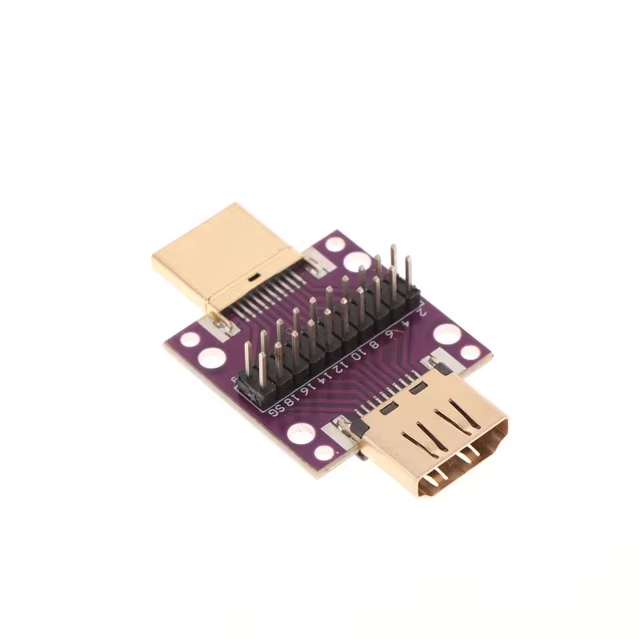
- Терминал UART: MobaXterm, PuTTY или аналог (нужен такой, в котором ввод отправляется сразу, а не по отдельной кнопке).
- ПК: для терминала UART и копирования файлов.
- USB-накопитель (флешка), отформатированный в **FAT32**, один раздел.
- Интернет на ТВ (RootMate сам скачивает Magisk) или Magisk APK на накопителе.

## 2. Собираем адаптер UART

| Контакт HDMI телевизора | Назначение относительно ТВ | Подключение USB–UART |
| --- | --- | --- |
| **2** | **TX** ТВ | **RX** адаптера |
| **8** | GND | GND адаптера |
| **14** | **RX** ТВ | **TX** адаптера |

VCC адаптера не подключать.

## 3. Готовим накопитель

На ПК отформатируйте накопитель в **FAT32**, один раздел. Скачайте и положите на него:

- **RootMate-1.0.apk**: [последний релиз](https://github.com/Tobirg/changhong_m9617_root/releases/latest).
- По желанию [Magisk APK](https://github.com/topjohnwu/Magisk/releases/latest): понадобится, если на ТВ нет интернета.

> **Не удаляйте с накопителя файлы, которые записал MBOOT** (`PTABLE.BIN`, `ENV.TXT`, `*.IMG`, `*.CRC`, `*.OK`), даже если они больше не нужны. MBOOT помечает конец файла в таблице FAT значением `0xFFFFFFFF`; если такой файл удалить и Android займёт его место, MBOOT не сможет прочитать новые файлы (`Invalid FAT entry`). Чтобы начать заново, скопируйте нужное на ПК и отформатируйте накопитель целиком. Файлы, которые записало приложение (`*.txt`, `*_magisk_patched*.img`), удалять можно.

## 4. Подключаем к ТВ

- Адаптер UART: в **HDMI порт 3** (отсчёт снизу вверх), другой конец в USB на ПК.
- Накопитель: в **USB-порт ближе к матрице**. Используйте этот порт на всех шагах: в Android он работает стабильно, к нему же обращаются скрипты в MBOOT (`usb start 1`).

На ПК откройте терминал на COM-порту адаптера с параметрами **115200, 8N1, без flow control**.

## 5. Установка RootMate и подготовка ТВ

Откройте на ТВ штатный файловый менеджер и установите с накопителя **RootMate-1.0.apk** (разрешите установку из неизвестных источников). Если менеджер не умеет открывать APK, поставьте приложение через `adb install`.

Откройте RootMate. При первом запуске откроется экран **Разрешения**, выдайте все три:

- **Доступ ко всем файлам**: работа с файлами на накопителе.
- **Установка неизвестных приложений**: установка Magisk.
- **Режим разработчика и отладка по USB (adb)**: так приложение само перезагружает ТВ в MBOOT. Кнопка откроет нужный раздел настроек: сначала «Об устройстве», где нужно 7 раз нажать **Сборка**, затем «Для разработчиков», где включается **Отладка по USB**.

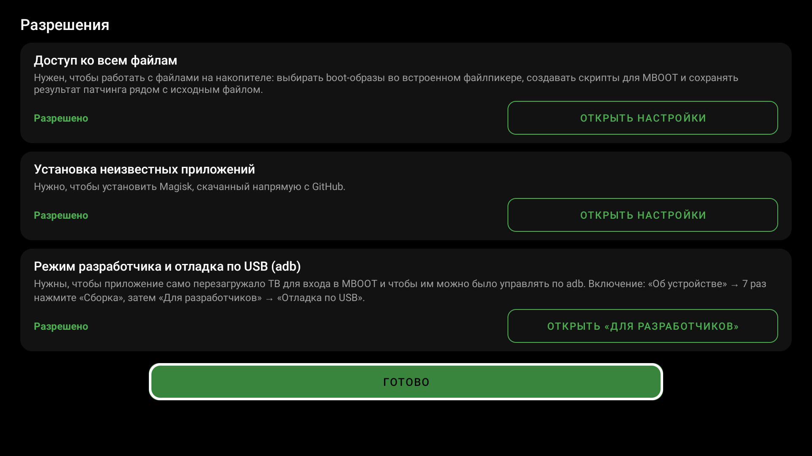

Главный экран: слева кнопки, справа лог.

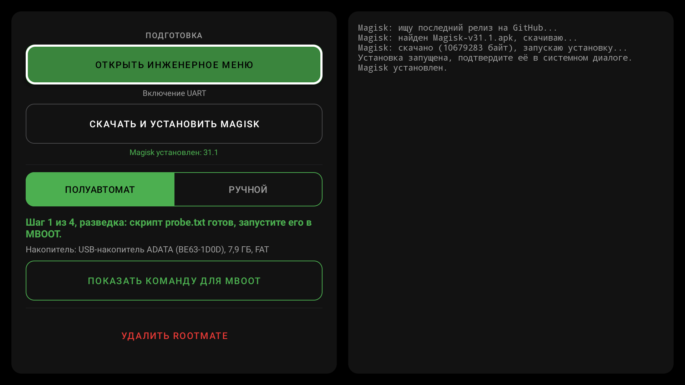

Нажмите **Скачать и установить Magisk**. Приложение найдёт последнюю версию на GitHub, скачает её и запустит установку; подтвердите в системном диалоге (**Установить**). Под кнопкой появится строка **Magisk установлен** с номером версии. Открывать Magisk и патчить через него ничего не нужно.

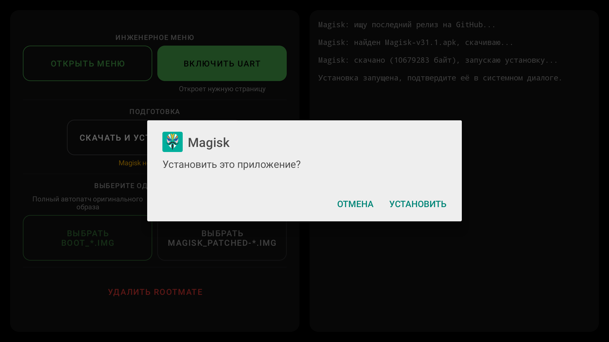

## 6. Включение UART

На многих прошивках UART в ТВ выключен: терминал молчит, и в консоль MBOOT не попасть. Включите его до начала шагов, из Android:

1. В RootMate нажмите **Открыть инженерное меню** (подпись «Включение UART»). Откроется страница **Design Mode** инженерного меню.
2. Выберите строку **Uart** и стрелками пульта переключите её в **On**. Остальные пункты не трогайте.
3. Выйдите кнопкой «Назад» (может понадобиться нажать её дважды).

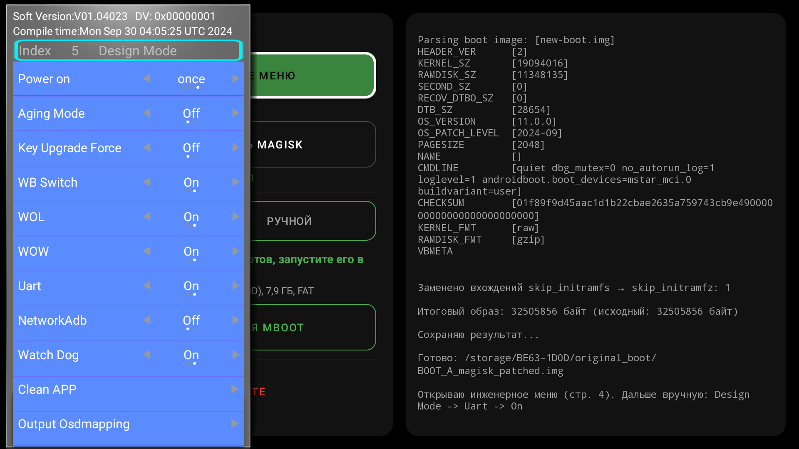

Настройка сохраняется после перезагрузки. Проверка: откройте терминал (115200, 8N1) и перезагрузите ТВ (кнопкой в RootMate, через **Настройки → Система → Перезагрузить** или из розетки), в терминале должен побежать лог загрузки. Если пусто, проверьте, не перепутаны ли TX и RX, и что адаптер в HDMI-порту 3.

## 7. Полуавтомат: четыре шага

Режим **Полуавтомат** включён при запуске. Под переключателем режимов приложение показывает, на каком вы шаге (например «Шаг 1 из 4, разведка: ещё не начата»), с каким накопителем работает и что делать дальше (главная кнопка). Шаг определяется по файлам на накопителе, поэтому после каждой перезагрузки ТВ приложение само продолжает с нужного места и предлагает следующее действие.

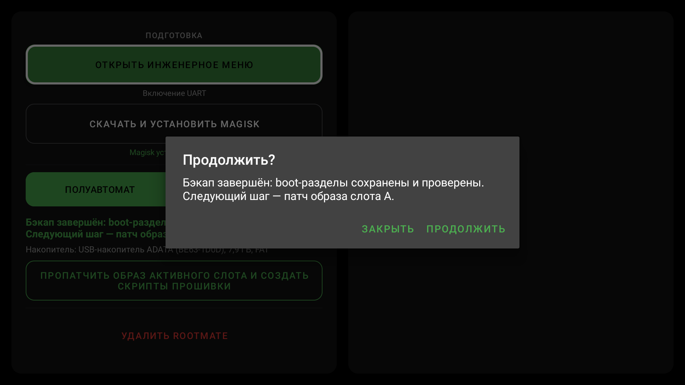

Накопитель для шагов выбирается один раз. Если вставлено несколько, приложение спросит, с каким работать. После форматирования у накопителя новый серийный номер: приложение предложит перейти на него одной кнопкой. Накопитель в exFAT/NTFS или с FAT не на первом разделе оно сразу отклонит: MBOOT такой не прочитает.

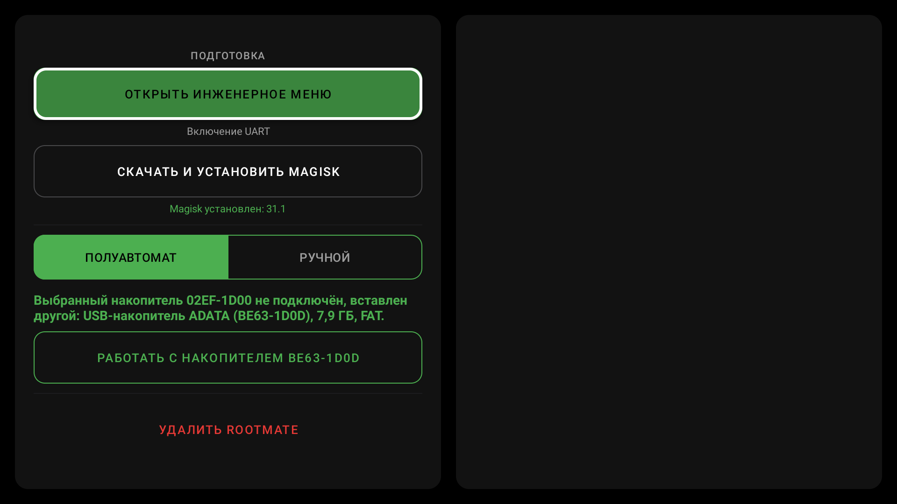

Шаги 1, 2 и 4 заканчиваются запуском скрипта в консоли MBOOT. Как это делается, подробно описано в шаге 1; дальше то же самое, меняется только имя скрипта.

### Шаг 1. Разведка

1. В RootMate нажмите **Создать скрипт разведки**. Приложение запишет на накопитель `probe.txt` и покажет подсказку с командами.
2. **Войдите в консоль MBOOT.** Откройте терминал UART на ПК, сделайте его окно активным и **зажмите Enter**. Не отпуская Enter, перезагрузите ТВ любым способом:
   - кнопка **Перезагрузить ТВ** в подсказке RootMate (через adb; первый раз ТВ спросит «Разрешить отладку по USB?»: выберите **Всегда разрешать**);
   - **Настройки → Система → Перезагрузить** (внизу списка) → подтвердите;
   - выключите ТВ из розетки и включите снова.

   **Держите Enter**, пока в терминале не появится приглашение:
   ~~~text
   << MT5889 >>#
   ~~~
3. Подключите накопитель в MBOOT:
   ~~~text
   usb start 1
   ~~~
   Ответ должен заканчиваться так:
   ~~~text
   1 USB Device(s) found
          scanning bus for storage devices... max lun:0
   1 Storage Device(s) found
   ~~~
   Если ответ `Error, couldn't init Lowlevel part`, повторите `usb stop` и `usb start 1`. Если устройств 0, накопитель вставлен не в тот USB-порт.
4. Запустите скрипт:
   ~~~text
   udstar probe.txt
   ~~~
   В начале `udstar` пишет `Saving Environment to MMC`: так MBOOT сохраняет свои переменные, разделы не трогаются. Дальше скрипт печатает свои команды и в конце `PROBE_OK`. **После этого ТВ перезагрузится сам** и загрузит Android: ничего нажимать не нужно, Enter больше не держите (иначе ТВ снова остановится в MBOOT).

Разведка ничего не пишет в eMMC: она сохраняет на накопитель таблицу разделов `PTABLE.BIN` и окружение загрузчика `ENV.TXT` (в нём серийный номер ТВ, не публикуйте его).

### Шаг 2. Бэкап

1. После загрузки откройте RootMate: оно увидит результат разведки и предложит продолжить. Кнопка **Создать скрипт бэкапа**: приложение запишет `backup.txt` с именами, размерами и адресами памяти именно вашего ТВ.
2. Войдите в консоль MBOOT, как в шаге 1: зажмите Enter в терминале и перезагрузите ТВ, держите Enter до `<< MT5889 >>#`.
3. Введите:
   ~~~text
   usb start 1
   ~~~

   ~~~text
   udstar backup.txt
   ~~~
   В конце будет `BACKUP_OK`, и ТВ сам перезагрузится в Android.

Скрипт сохраняет `boot_a`, `boot_b` и `misc` в `BOOT_A.IMG`, `BOOT_B.IMG`, `MISC.IMG` (если такие файлы уже есть, берёт `_2`, `_3`…), читает каждый файл обратно и сверяет с eMMC, рядом пишет `*.CRC`. В eMMC он ничего не пишет. Приложение потом само пересчитывает CRC32 и размеры и только после этого считает бэкап готовым.

**Сразу скопируйте `BOOT_A.IMG` и `BOOT_B.IMG` на ПК и храните там.** Это единственный способ откатиться.

> Если на ТВ уже был root, образ активного слота в бэкапе уже пропатчен Magisk. Патч всё равно соберётся правильно, но приложение предупредит: `rollback.txt` вернёт этот же пропатченный образ, а не заводской. Для отката держите заводской образ отдельно.

### Шаг 3. Патч

Этот шаг идёт только в Android, в MBOOT заходить не нужно. Откройте RootMate после загрузки и нажмите **Пропатчить образ активного слота и создать скрипты прошивки** (нужен Magisk). Приложение само:

- берёт из бэкапа образ **активного слота** (того, с которого ТВ загружается сейчас; другой слот прошивать бесполезно);
- запускает `boot_patch.sh` из установленного Magisk и применяет фикс `skip_initramfs` (ниже);
- сохраняет `BOOT_X_magisk_patched.img` рядом с бэкапом (размер совпадает с исходным);
- пишет `check.txt`, `flash.txt` и `rollback.txt` с вашим слотом, именами файлов и контрольными суммами CRC32.

Это занимает около минуты, кнопки на это время заблокированы. Не выходите из приложения. В конце приложение покажет подсказку для шага 4:

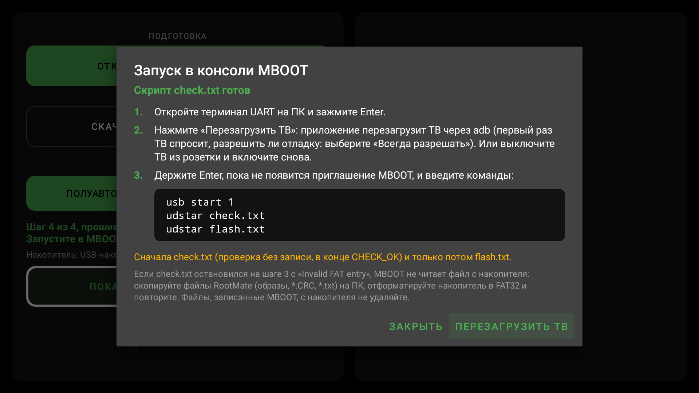

> **Что за фикс skip_initramfs.** На этой версии MBOOT в командной строке ядра есть `skip_initramfs`, и Magisk из-за этого ошибочно выбирает Legacy SAR вместо First Stage Init. Помогает замена одного символа в **magiskinit** (файл `init` внутри ramdisk): `skip_initramfs` → `skip_initramfz`. RootMate делает это инструментом `magiskboot` из самого Magisk.

### Шаг 4. Проверка и прошивка

1. Войдите в консоль MBOOT, как в шаге 1: зажмите Enter в терминале и перезагрузите ТВ (кнопка **Перезагрузить ТВ** в подсказке, настройки или розетка), держите Enter до `<< MT5889 >>#`. Подсказку можно открыть снова кнопкой **Показать команду для MBOOT**.
2. Запустите проверку:
   ~~~text
   usb start 1
   ~~~

   ~~~text
   udstar check.txt
   ~~~
   `check.txt` выполняет все проверки прошивки, ничего не записывая: активный слот в `misc`, CRC32 бэкапа и пропатченного образа. В конце должно быть `CHECK_OK_slot_a_nothing_written` (или `_b`). ТВ остаётся в MBOOT, выходить из консоли не нужно.
3. **Только после `CHECK_OK`** запустите прошивку:
   ~~~text
   udstar flash.txt
   ~~~
   `flash.txt` повторяет проверки, разблокирует загрузчик (`devicestate unlock`), записывает образ в boot-раздел активного слота, читает его обратно и сверяет, в конце пишет `FLASH_OK_slot_…` и перезагружает ТВ. Любая неудачная проверка останавливает скрипт до записи.

**Если ТВ ещё не разблокирован** (состояние загрузки не `orange`), `flash.txt` перед перезагрузкой **сбрасывает пользовательские данные**: без этого ТВ не загрузится из-за ключей шифрования. После сброса ТВ придётся настроить заново, включая режим разработчика и отладку, а RootMate и Magisk удалятся вместе с данными. Установите Magisk снова: APK с накопителя или **RootMate-1.0.apk** → **Скачать и установить Magisk**. **После установки сразу нажмите «Открыть»**: ярлыка в штатном лаунчере не будет (позже открыть можно через настройки Android). На запрос дополнительной установки соглашайтесь.

Если ТВ уже был разблокирован, сброса нет, приложение покажет «Прошивка завершена (FLASH.OK)».

### Проверка

В Magisk должен быть виден установленный root. Или по adb:
~~~bash
adb shell getprop ro.boot.slot_suffix
adb shell getprop ro.boot.verifiedbootstate
adb shell "su -c id"
~~~
Слот совпадает с прошитым, `verifiedbootstate` равен `orange`, `su` возвращает `uid=0` (первый раз Magisk спросит на экране ТВ, разрешить ли root для shell).

## 8. Если что-то пошло не так

| Что видно | Что делать |
| --- | --- |
| `Invalid FAT entry` (чаще всего `check.txt` останавливается на шаге 3) | MBOOT не может прочитать файл с накопителя: с него удаляли файлы MBOOT. Скопируйте файлы RootMate на ПК, отформатируйте накопитель в FAT32 и пройдите шаги заново. |
| Скрипт остановился на `cmp` | Проверка не прошла, всё после неё не выполнялось. По последнему `STEP…`/`BACKUP_…` видно, какая. Создайте скрипт заново из приложения. |
| Терминал молчит при загрузке ТВ | UART выключен в ТВ (шаг 6), перепутаны TX/RX или адаптер не в HDMI-порту 3. |
| `usb start 1` находит 0 устройств | Накопитель вставлен не в тот USB-порт или он не FAT32. |
| «Перезагрузить ТВ» не работает | Не включены режим разработчика и отладка по USB (экран «Разрешения») или отладка не разрешена. Перезагрузите ТВ через **Настройки → Система → Перезагрузить** или из розетки. |
| Приложение пишет про несовместимую файловую систему или раздел | Отформатируйте накопитель целиком в FAT32, один раздел. |
| После прошивки ТВ не загружается | [recovery.md](recovery.md); откат ниже. |

## 9. Откат

Войдите в консоль MBOOT, как в шаге 1 раздела 7 (Enter в терминале и перезагрузка ТВ), и введите:
~~~text
usb start 1
~~~

~~~text
udstar rollback.txt
~~~

`rollback.txt` создаётся вместе с `flash.txt`: проверяет слот и оригинальный образ по CRC32, ставит `devicestate lock`, записывает оригинал, проверяет запись, сбрасывает данные и перезагружает ТВ. Ручной откат: [приложение Б](#приложение-б-ручные-команды-mboot).

Для агентов (ИИ или скриптов), которые проходят эти шаги через adb и UART: [agent.md](agent.md).

---

## Приложение А. Ручной режим RootMate

Переключатель **Ручной** нужен, если у вас уже есть свой образ boot или образ, пропатченный в самом Magisk. Скрипты для MBOOT в этом режиме не создаются: прошивка вручную, [приложение Б](#приложение-б-ручные-команды-mboot). Над кнопками показан активный слот: прошивать нужно образ именно этого слота.

- **Выбрать BOOT_\*.IMG**: полный патч оригинального образа Magisk и фикс `skip_initramfs`; результат `<имя>_magisk_patched.img` рядом с исходным.
- **Выбрать magisk_patched-\*.img**: только фикс для образа, который уже пропатчил Magisk (**Установка → Пропатчить boot-образ**); результат `<имя>_skipfix.img`.

Файл выбирается во встроенном файлпикере: сначала накопитель, затем файл.

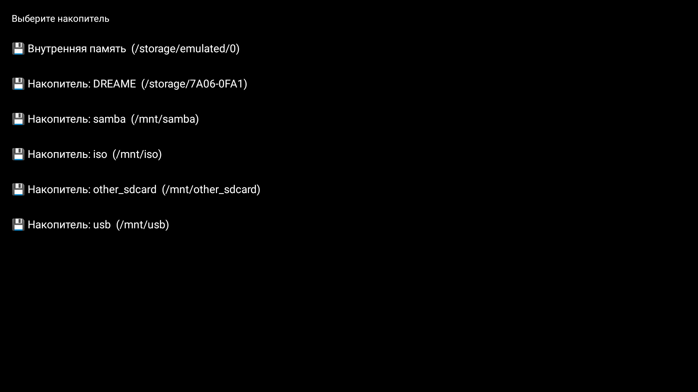

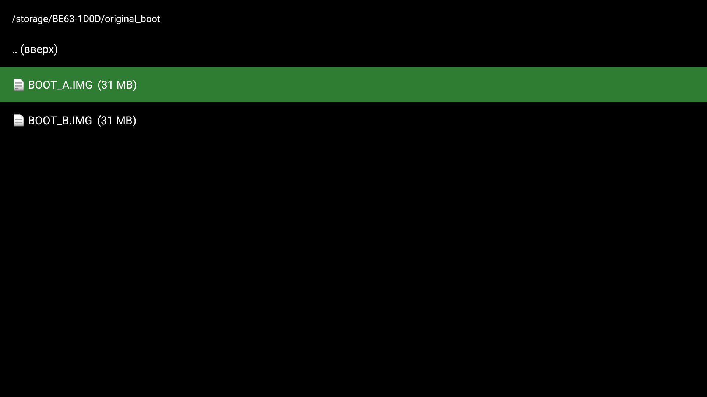

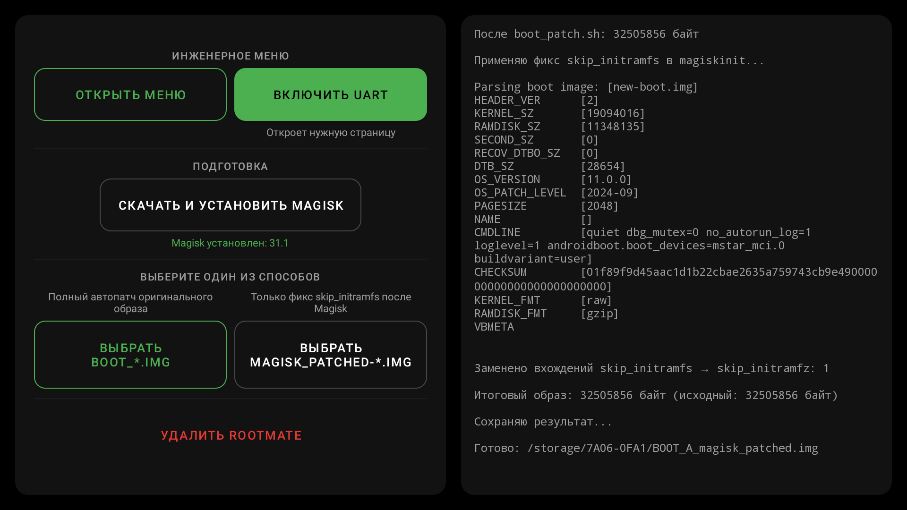

Если имя образа говорит о другом слоте, чем активный, после патча в конце лога будет крупное жёлтое предупреждение. Если файл с таким именем уже есть, новый получит суффикс `_2`, `_3`…

Без приложения фикс можно сделать через adb:
~~~bash
adb push scripts/skipfix.sh /data/local/tmp/skipfix.sh
adb shell sh /data/local/tmp/skipfix.sh magisk_patched-....img
~~~

## Приложение Б. Ручные команды MBOOT

Ниже `X` — буква активного слота (`a` или `b`): RootMate показывает её в ручном режиме, по adb это `adb shell getprop ro.boot.slot_suffix`. Переключение слотов (`_a` ↔ `_b`) не используется: на исследованном ТВ оно зависало.

### Бэкап вручную

Узнайте адрес RAM и размер boot-образа:
~~~text
printenv bootcmd
~~~
~~~text
bootcmd=mmc read.p 0x25000000 boot 0x1F00000; bootm 0x25000000
~~~
Если значения другие, подставляйте свои. Снимите оба слота по очереди:
~~~text
usb start 1
~~~

~~~text
mmc read.p 0x25000000 boot_a 0x1F00000
~~~

~~~text
fatwrite usb 0:1 0x25000000 BOOT_A.IMG 0x1F00000
~~~

~~~text
mmc read.p 0x25000000 boot_b 0x1F00000
~~~

~~~text
fatwrite usb 0:1 0x25000000 BOOT_B.IMG 0x1F00000
~~~

~~~text
fatls usb 0:1
~~~

~~~text
usb stop
~~~

~~~text
reset
~~~
`fatls` должна показать оба файла размером с boot-раздел (второе число из `bootcmd`; в примере 0x1F00000 = 32505856 байт).

### Прошивка вручную

~~~text
setenv devicestate unlock
~~~

~~~text
saveenv
~~~

~~~text
printenv devicestate
~~~

~~~text
usb start 1
~~~

~~~text
fatls usb 0:1
~~~

~~~text
fatload usb 0:1 0x25000000 BOOT_X_magisk_patched.img
~~~

~~~text
mmc write.p 0x25000000 boot_X 0x1F00000 0
~~~

~~~text
recovery_wipe_partition data
~~~

~~~text
reset
~~~
`printenv devicestate` должна показать `devicestate=unlock`, `fatload` — прочитать ровно размер boot-раздела (то же число из `bootcmd`), иначе остановитесь. `recovery_wipe_partition data` удаляет пользовательские данные; **если ТВ после прошивки не загружается, скорее всего пропущен этот шаг**.

### Откат вручную

Пишется **исходный образ активного слота**:
~~~text
setenv devicestate lock
~~~

~~~text
saveenv
~~~

~~~text
usb start 1
~~~

~~~text
fatload usb 0:1 0x25000000 BOOT_X.IMG
~~~

~~~text
mmc write.p 0x25000000 boot_X 0x1F00000 0
~~~

~~~text
recovery_wipe_partition data
~~~

~~~text
reset
~~~

**Если оригинальный образ активного слота потерян**, можно записать в него содержимое соседнего слота, предполагая, что тот не менялся. Например, активен слот A: вместо `fatload` выполните `mmc read.p 0x25000000 boot_b 0x1F00000`, затем те же `mmc write.p ... boot_a`, `recovery_wipe_partition data`, `reset`. Для слота B наоборот.
